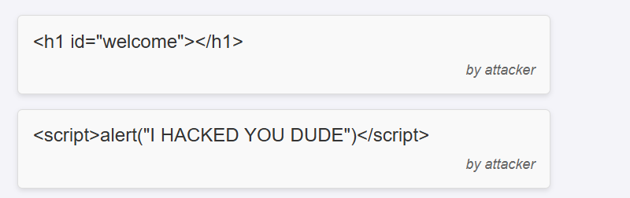

# passman: hardening a vulnerable PHP password manager


A security assignment for **Information Systems Security** (Aristotle University of Thessaloniki, ECE, 2025–26).
The course provided **passman**, a small PHP/MySQL password manager with deliberate vulnerabilities. The task
was to attack it, fix what you found, and document the results.

**What I did:**

1. **Exploited and fixed** SQL injection (`' OR 1=1; -- ` dumped every user's saved credentials), plaintext
   password storage, and stored XSS (cookie theft via the notes page). I also moved the site to HTTPS.
2. **Then reviewed my own fixed version** and found issues beyond the assignment's scope. The worst was an
   IDOR that let any user delete anyone else's saved passwords. I fixed those too, along with CSRF,
   session fixation, cookie flags, bcrypt and security headers.
3. **Added an end-to-end test suite** that attacks the running app, plus a Docker setup and CI. Run
   against the original submission, the suite fails the 9 checks for the follow-up issues.

Full details, including what is still *not* fixed: **[SECURITY.md](SECURITY.md)**.
Original reports (with screenshots): [English](docs/report-en.pdf) · [Greek](docs/report-gr.pdf).

| Stored passwords are AES-256-GCM ciphertext in the database | XSS payloads in notes now render as plain text |
|---|---|
|  |  |

## Run it

```bash
docker compose up --build
# open http://localhost:8080/passman/
```

Then, in another terminal, attack it with the test suite:

```bash
bash tests/security_test.sh http://localhost:8080/passman
```

```
[Access control]
  PASS  bob cannot delete alice's entry (IDOR)
  PASS  bob cannot see alice's entry
[CSRF]
  PASS  delete without CSRF token is refused (403)
  ...
21 passed, 0 failed
```

Without Docker: the app also runs on XAMPP like the course setup. Copy `passman/` into `htdocs`, import
`passman/create-pwd_mgr-db-withData.sql`, and it connects as `root` with no password by default. Override
that with the `DB_HOST`, `DB_USER`, `DB_PASS`, `DB_NAME` and `DB_PORT` environment variables.

## Layout

```
passman/                 the application
  bootstrap.php          shared session hardening, CSRF, headers, DB connection (added in hardening)
  login.php register.php dashboard.php notes.php logout.php
  test_hash.php test_encrypt.php   hashing / AES-GCM helpers provided by the course
  xss/                   attacker-side pages for the XSS exercise (cookie collector), not part of the app
tests/security_test.sh   black-box security regression tests (bash + curl)
docs/                    submitted reports
```

## History

- Tag **`course-submission`**: the code exactly as submitted in January 2026.
- Branch **`security-hardening`**: the follow-up fixes, tests, Docker and CI.

The starting application and the helper functions in `test_hash.php` / `test_encrypt.php` were provided by
the course. The vulnerability fixes, hardening, tests and reports are my own work.

Author: Stergios Loukas
